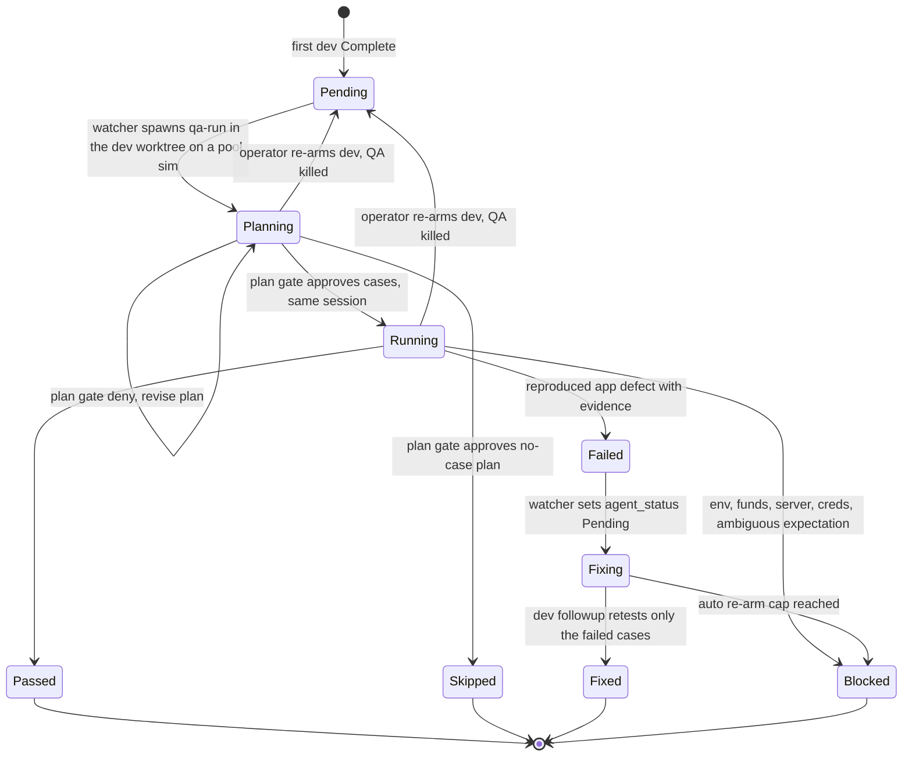

# QA run: design

Status: agreed design, not built. Source of truth for `/author` when the `qa-run` skill, its judge rubric, and the watcher and hook changes are written. Supersedes the human `QA:` subtask handoff in `/pr-land` step 10.

## Purpose

After a dev run finishes, an independent agent session tests the corner cases the dev run did not reach. It runs asynchronously: it never blocks the dev run's `Complete`, and it waits in the queue without a sim.

Principles:

- **Beyond the dev run, never a repeat.** The dev run's `/build-and-test` already proves the main path. QA tests only cases that are uncovered, reachable from the diff, a state a real user can be in, and worth the cost. When no such case exists, QA ends in Skipped (a copy change is the canonical example).
- **Independent context.** QA is a fresh session working from the task, the diff and the dev run's report. It is never a resume of the dev transcript, which already believes its own testing.
- **Cheap by construction.** QA reuses the dev worktree and the dev run's cached app. One session runs the whole pass on a pool sim, and only tasks whose dev run had a sim lane get QA; a no-sim dev run relies on its own testing.
- **No hacks.** QA drives only what the app can reach without editing tracked files.
- **A failure is a dev followup.** A real failure re-arms the dev run automatically, with the QA findings as its followup scope. An environment wall is Blocked, which is not a failure and re-arms nothing.

## Lifecycle

A new Asana enum field, `agent_qa`, carries QA state beside `agent_status`. `agent_status=Complete` stays truthful about the dev run regardless of QA.

| State | Meaning | Set by |
|---|---|---|
| Pending | Queued for QA | one-shot at the first dev `Complete`; the watcher when a re-arm interrupts QA; the operator by hand to force a fresh QA pass |
| Planning | QA session running its plan step (its sim held, not driven) | the QA session at start |
| Running | Plan approved, cases being driven | the QA session after the plan gate passes |
| Passed | Every planned case passed | QA verdict script |
| Skipped | No reasonable corner case exists; one-line reason posted | QA verdict script (judged at the plan gate) |
| Blocked | An environment or precondition wall stopped a case after documented attempts, or the expected result is ambiguous in the task | QA verdict script |
| Failed | An app defect reproduced on the pinned sha | QA verdict script |
| Fixing | Dev followup re-armed from a Failed verdict | the watcher, when it re-arms |
| Fixed | Dev followup retested the failed cases and reached `Complete` | one-shot at `Complete` when `agent_qa=Fixing` |

**QA runs once per task.** Only the first dev `Complete` queues it. Later Completes (review-comment followups, a QA-failure followup) do not queue it again; a QA-failure followup moves `Fixing` to `Fixed`. The operator can set `agent_qa=Pending` by hand to force another pass. The one automatic re-queue is a dev re-arm that interrupts QA mid-run: the watcher kills the QA session, resets `agent_qa=Pending`, and QA runs after the next dev `Complete` because it never finished.

**Auto re-arm cap: 2 per task.** A third Failed verdict on the same task becomes Blocked with the reason "auto re-arm cap reached", which hands the loop to the operator. The count is the number of attached QA reports whose verdict is Failed.

## Scheduling

- The watcher gets a second queue: tasks with `agent_status=Complete` AND `agent_qa=Pending`, oldest first.
- QA is lower priority than dev Pending work and has its own concurrency cap (start at 1). It never takes a sim a dev task could use.
- One session per pass. The watcher spawns QA with a pool sim, a slot and Metro, under the same sim cap as dev runs and only when no dev sim task is waiting. The session plans, passes the plan gate and drives in place; a crash respawns it, and `qa-start.sh` resumes the phase from the pass dir.
- The prompt is `/qa-run --yolo <task-url>`, in tmux session `qa-asana-<gid>`, cwd the dev worktree, env `AGENT_TASK_GID=<gid>` and `AGENT_MODE=qa`.
- The watcher's Failed handling: on a tick that sees `agent_qa=Failed` and `agent_status=Complete`, and the cap not reached, it sets `agent_qa=Fixing` then `agent_status=Pending`. The normal Pending path resumes the dev transcript.

## Resources

- **Worktree.** QA runs in `~/git/.agent-worktrees/<gid>/<repo>`, the dev run's own worktree, with its node_modules, Pods and DerivedData. The session watchdog's completion sweep and `gc-worktrees.sh` spare a task's worktrees while `agent_qa` is Pending, Planning or Running, and release them on any other state. A dev worktree already pruned when QA starts (e.g. after a reboot GC) is re-provisioned on the PR head branch with `setup-task-workspace.sh --existing-branch`, the same recovery a dev followup uses.
- **No installs.** QA never runs an install step (`npm ci`, `yarn`, `pod install`). Install steps rewrite lockfiles and revert updot dependency links that a dev run relying on an unpublished dependency set up.
- **No build: the dev run's app is reused.** The dev run's Debug `.app` is already in the native app cache (`build-and-test/scripts/lib/native-app-cache.sh`), keyed by the tree's native state. QA's tree is the dev tree at the same clean HEAD, so the key matches and `ios-rn-build.sh` installs the cached app on the pool sim in seconds with no Xcode compile. The JS comes live from the slot's Metro bundling the same worktree. Two requirements:
  - **Pin the entry.** The cache keeps the 8 most recently used entries per bundle id (`NATIVE_APP_CACHE_KEEP`). While `agent_qa` is Pending, Planning or Running, the dev run's entry is exempt from trimming, so a busy queue cannot evict it before QA starts. The dev run records the key at `Complete`.
  - **A miss is a fallback, not a wall.** If the entry is still missing (cache cleared, dev build predates the cache), QA runs the normal `ios-rn-build.sh` build once and says so in the QA report. A dirty native tree never reaches this point: the snapshot check would already have refused it.
- **What a QA run holds.** A pool sim, a slot and a Metro instance for the whole pass, planning included (the cost of one session: a plan-only or skip pass holds the sim for its planning minutes). No Xcode build, no install, no new worktree.
- **Pinned sha.** QA tests the worktree's HEAD as it stands at start, which must equal the PR head. It never checks anything out. A dev branch that moved by verdict time makes the result stale and the verdict script refuses it.
- **Snapshot check.** At QA start the verdict script records HEAD, `git status --porcelain`, the dependency link state and hashes of the worktree's app config copies (`config.json`, `env.json`, `keys.json`). It refuses any verdict until the tree matches. The dev followup that a Failed verdict re-arms resumes in this tree, so a dirty tree would poison it. This is a mechanical check, not a judge dimension.

## Planning phase

Runs in the dev worktree; the session's sim is held but not driven. Produces one plan file, `/tmp/qa-plan-<gid>.md`, which becomes a section of the QA report and the plan gate's evidence.

1. **Ingest.**
   - the task, via `asana-get-context.sh`;
   - every dev run report on the task: its Testing section, `verify_blockers`, the not-tested list, and the environment line (account, asset, funding, any provider forcing);
   - the PR diff at the pinned head sha, the PR body's Testing section, and the task's `tested` field.
2. **Coverage map.** Every behavior the diff changes, each row marked covered by dev (citing the report line or screenshot) or uncovered.
3. **Cases.** Candidates come from the uncovered rows plus boundary states on covered paths: zero or max balance, token vs mainnet, Back after a provider redirect, an error response the app can be made to receive without code edits, a second wallet, a sibling asset on the same plugin. A candidate survives only when it is:
   - reachable from the changed code path;
   - a state a real user can be in;
   - reachable without a hack (a hack-only case goes to the not-covered list with its reason, never into a verdict);
   - within budget: about 5 cases, and estimated fees within the pass's $20 budget.

   Out of scope by rule: rerunning the happy path, re-checking dev screenshots, sweeping every asset or provider.

   Each surviving case records the scenario, preconditions (account, asset, amount, wallet state), steps, the expected result and where it comes from (task, spec, or prior app behavior), why the dev run did not cover it, and its cost.
4. **Resource plan.**
   - **Account.** Parity with the dev run: the account its environment line names, which by default is the roster `agent` role. A different roster account, or a newly created throwaway account, only when a case requires it (first-run state needs a fresh account; a receive needs a second account). The plan names the case that requires it.
   - **Funds.** Asset and amount per case, and the swap-to-fund plan, under `/build-and-test`'s funding rules. Swaps keep the value as another asset, so only their fees (plus network fees) count against the pass's $20 budget. Funding may take swaps across several pairs to reach the target asset, and a case that consumes the asset is refunded by another swap.
   - **Lane.** iOS sim by default; Android or none when the cases need it.
   - **External dependencies.** Servers and providers the cases touch are probed now, before any drive, so a Blocked wall surfaces before drive time is spent.
5. **Decision.** No surviving case means a Skipped plan with its reason. Otherwise a plan with cases. Either goes to the plan gate.

## Running phase

- QA invokes `/build-and-test` with the approved case list as its scope and a QA mode flag. It inherits `/build-and-test`'s whole drive and funding machinery: the roster, `agent-account-acquires-by-swap`, `create-missing-destination-wallet`, `asset-priority`, `/debugger`. QA has no testing machinery of its own.
- The QA mode flag turns off `hack-verify-visual-changes` and forbids any edit to a tracked file.
- **Config switches are allowed** when they are the documented runtime switches dev runs already use (provider forcing, `DEBUG_*` plugin flags). They are runtime config, not code. Each is reverted before the verdict, and the snapshot check proves it.
- A case not in the approved plan is never driven. Driving one is a plan-adherence deny at the verdict gate.

## Verdicts

One script posts every verdict. It sets `agent_qa`, posts the comment, and attaches the report together, after the snapshot check and the judge pass.

| Verdict | Class (one-shot `verify_blockers` vocabulary) | Requires |
|---|---|---|
| Passed | n/a | every planned case driven to its expected result, with proof screenshots |
| Skipped | n/a | the plan gate's approval of the no-case reason |
| Blocked | `precondition` or `harness`: server unreachable, funds still short after a swap-to-fund attempt, a credential still missing after checking the 1Password Agent Share vault, a provider down | the documented attempts; the comment names the missing precondition. The task's `blocked` field is not touched: the dev work is done |
| Blocked | `task-drafting`: the behavior is arguably fine and the task does not say | the two readings, stated plainly; the operator decides whether it is a bug |
| Failed | `code`: an app defect | reproduction on the pinned sha with steps, expected vs actual, the source of the expectation, and a screenshot |

**Outputs.**

- One Asana comment on the task: a pass/fail table per case, plus the not-covered list. Written for the operator in plain words (no bare identifiers).
- One attachment named `<N>-qa-report.md`. It must NOT match the run-report name (`lib/attach-names.sh` `REPORT_ATTACH_RE`), because the followup watermark is the newest run report, and a QA report counted as one would move the watermark past its own findings.
- No PR comment.

## Judge

Same machinery as the completion judge: a gate hook, an evidence bundle, `claude -p` outside the run, cached verdicts, operator waivers. Separate rubric file and events, so the completion rubric (`completion-judge/references/rubric.md`) does not grow.

**Plan gate** (event `qa-plan`, before any drive). A deny costs one judge call and no drive.

| Dim | Question |
|---|---|
| P1 delta-only | Does any case repeat what a dev run report's Testing section already proved? |
| P2 case-reasonableness | Is each case reachable from the diff, a real user state, reachable without a hack, and within budget? |
| P3 skip-validity | For a Skipped plan: does the diff have an obvious uncovered path the plan missed? |
| P4 account-parity | Does the plan use the dev run's account, or name the case that requires another or a new one? |

**Verdict gate** (events `qa-passed`, `qa-blocked`, `qa-failed`; Skipped was settled at the plan gate). `qa-failed` matters most because it re-arms a dev run.

| Dim | Question |
|---|---|
| V1 plan-adherence | Were exactly the approved cases driven, with nothing added? |
| V2 failure-evidence | Reproduced on the pinned sha, with steps, a screenshot, and an expectation sourced from the task, spec or prior behavior; not a harness artifact? A Failed claim without this is reclassified as Blocked, not passed through. |
| V3 blocked-validity | Is the wall real after the documented attempts (swap-to-fund, Agent Share vault, server probe)? A deny names the attempt to make. |
| V4 account-and-funds | Did the drive use the account the plan approved, and fund under `/build-and-test`'s rules? |
| V5 report-honesty | Do the comment and report match the evidence? |

## Failure loop

1. QA posts Failed. The watcher sets `agent_qa=Fixing` and `agent_status=Pending` (cap permitting).
2. The watcher resumes the dev transcript in the same worktree on a fresh slot.
3. `check-followup-scope.sh` includes the newest Failed QA report newer than the run-report watermark as scope. Its agent-authored filter drops 🥋-marked comments, and the QA comment is agent-authored, so this needs an explicit exception keyed on the QA report attachment rather than the comment text.
4. The dev followup fixes the defect and retests only the failed cases from the QA report, not the full `/build-and-test` baseline. That narrows one-shot's followup retest bar for this followup type.
5. At `Complete`, one-shot sees `agent_qa=Fixing` and sets Fixed. QA does not run again.

## Session isolation

- **Hook profile.** `AGENT_MODE=qa` puts the hooks in a read-only profile: no commits, pushes, PR edits, or PR comments. The only Asana writes allowed are `agent_qa`, the one verdict comment, and the QA report attachment. QA never writes `agent_status`; the watcher does the re-arm.
- **Transcript lookup.** `resume-task.sh` resumes the newest transcript for the task by matching the task URL in its first prompt. A QA transcript contains that URL and is newer, so the lookup must match only `/one-shot` and `/task-run` prompts, or a dev re-arm would resume the QA session.
- **No retirement.** A QA session is killed after its verdict posts, never retired to a `done-asana-*` session. Retired dev sessions stay alive (up to `keep_completed_sessions`, about 0.9 GB each) so they can be resumed; a QA session is never resumed, so keeping it buys nothing.
- **Session kill.** The re-arm path kills `qa-asana-<gid>` before `resume-task.sh` runs, so the two sessions never share the worktree at once.

## Removed

`/pr-land` step 10's `QA:` subtask machinery: the Opus write-up subagent (`references/qa-writeup.md`), the `qa-subtasks-before-handoff` and `qa-writeups-by-opus-subagent` rules, `asana-task-update.sh`'s `QA_SUBTASKS_REQUIRED` gate and `--no-manual-qa`, the `QA_NOT_PLAIN` lint, and `asana-get-context.sh`'s `QA:` hiding. pr-land keeps only the board-state move. Existing tasks with `QA:` subtasks are left as they are.

## Implementation map

The 20,000-character cap (`cap-skill-slice-size.sh`) binds the one-shot, pr-land and build-and-test cores and slices. QA logic lives in the new skill; capped files only gain hooks into it.

| Piece | Change | Size note |
|---|---|---|
| `qa-run` skill (new) | core + slices: planning, running, verdict; verdict script with snapshot check | split from the start, each file under the cap |
| QA judge rubric (new) | plan gate and verdict gate dimensions above; launcher events in `completion-judge.sh` | separate file |
| `asana-watcher.js` | QA queue and cap; one sim-bound spawn per pass; Failed re-arm with cap; QA kill and reset on operator re-arm | |
| session watchdog, `gc-worktrees.sh` | spare worktrees while `agent_qa` is Pending, Planning or Running | |
| `resume-task.sh` | transcript match restricted to dev prompts | |
| `native-app-cache.sh`, one-shot `Complete` | dev run records its cache key; trim skips keys pinned by a task with `agent_qa` Pending, Planning or Running | |
| hooks | `AGENT_MODE=qa` profile | |
| `check-followup-scope.sh` | Failed QA report as scope | |
| `build-and-test` | QA mode flag: case-list scope, `hack-verify-visual-changes` off | core at 15,964; keep the addition to a few lines, the rules live in `qa-run` |
| one-shot | first `Complete` sets `agent_qa=Pending`; `Fixing` to `Fixed` at `Complete` (`references/finalize.md`, 13,209); retest-only-failed-cases (`references/followup.md`, 9,063) | |
| pr-land | remove step 10 QA machinery (`references/post-merge.md`, 10,909, shrinks) | |
| Asana + `asana-config.json` | create `agent_qa` with the nine options; add it to the config | |
